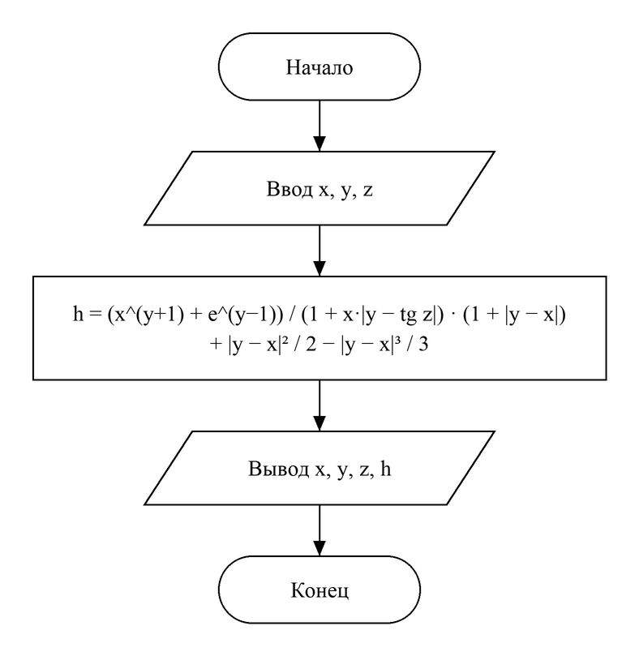

# Домашнее задание к работе №5
Вариант 15

## Условие задачи
Создать программу вычисления указанной величины. Результат проверить при заданных исходных значениях.

$$h = \frac{x^{y+1} + e^{y-1}}{1 + x\,|y - \mathrm{tg}\,z|}\,(1 + |y - x|) + \frac{|y - x|^2}{2} - \frac{|y - x|^3}{3}$$

Контрольный пример: при x = 2.444, y = 0.869·10⁻², z = −0.13·10³ результат **−0.49871**.

## 1. Алгоритм и блок-схема
### Алгоритм:
1. Начало.
2. Объявить вещественные переменные **x, y, z** — исходные данные и **h** — результат.
3. Ввести x, y, z.
4. Вычислить **h** по формуле с помощью функций из math.h: **pow, exp, fabs, tan**.
5. Вывести исходные данные и h с точностью 5 знаков после запятой.
6. Конец.

### Блок-схема:


## 2. Реализация программы
```c
#define _CRT_SECURE_NO_DEPRECATE
#define _USE_MATH_DEFINES
#include <stdio.h>
#include <locale.h>
#include <math.h>

// Вариант 15
// h = (x^(y+1) + e^(y-1)) / (1 + x*|y - tg z|) * (1 + |y - x|) + |y - x|^2 / 2 - |y - x|^3 / 3
// Контрольный пример: x = 2.444, y = 0.869e-2, z = -0.13e3, h = -0.49871
int main() {
    setlocale(LC_CTYPE, "RUS");
    double x, y, z, h;
    puts("h = (x^(y+1) + e^(y-1)) / (1 + x*|y - tg z|) * (1 + |y - x|) + |y - x|^2 / 2 - |y - x|^3 / 3");
    puts("Введите x, y, z");
    scanf("%lf %lf %lf", &x, &y, &z);
    h = (pow(x, y + 1) + exp(y - 1)) / (1 + x * fabs(y - tan(z))) * (1 + fabs(y - x))
        + pow(fabs(y - x), 2) / 2 - pow(fabs(y - x), 3) / 3;
    printf("При x = %g, y = %g, z = %g\nh = %.5f\n", x, y, z, h);
    return 0;
}
```

## 3. Результаты работы программы
Случай 1:
```
h = (x^(y+1) + e^(y-1)) / (1 + x*|y - tg z|) * (1 + |y - x|) + |y - x|^2 / 2 - |y - x|^3 / 3
Введите x, y, z
2.444 0.869e-2 -0.13e3
При x = 2.444, y = 0.00869, z = -130
h = -0.49871
```
Случай 2:
```
h = (x^(y+1) + e^(y-1)) / (1 + x*|y - tg z|) * (1 + |y - x|) + |y - x|^2 / 2 - |y - x|^3 / 3
Введите x, y, z
1 2 0.5
При x = 1, y = 2, z = 0.5
h = 3.19742
```

## 4. Информация о разработчике
Файко Андрей Юрьевич, бТИИ-262
